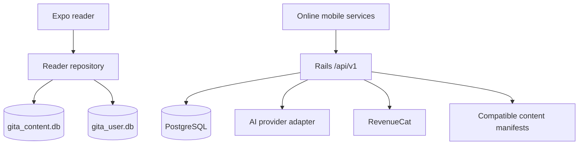

# Architecture

## Boundaries

`apps/mobile` is an Expo SDK 58 / React Native application with Expo Router and strict TypeScript. `services/api` is Rails API-only with PostgreSQL. `content` owns source data, validation, licenses and generation. `packages/storage` contains SQL shared between generation, migration tests and mobile initialization. npm workspaces manage JavaScript dependencies; Bundler manages Ruby separately.

No network call participates in reading, language changes, bookmarks or progress. Components render and handle gestures; repositories own SQL. Zustand holds ephemeral client preferences hydrated from user SQLite. TanStack Query is initialized for future remote state and must not become the canonical offline store. Query persistence is unnecessary for Sprint 1.

## Content and startup

Validate source JSON before creating SQLite. Generate a bundled content database with schema version, content version, source metadata, sample status and checksum manifest. Expo SQLite imports that asset on first use into a filename containing the content version, so bundled upgrades do not reuse a stale copy. Initialize mutable user SQLite using transactional `PRAGMA user_version` migrations; fail visibly on unsupported future schemas. Do not reset user data on migration failure. The content schema has foreign keys; references across files are checked by repositories.

Startup opens content, migrates user data, validates content metadata, reads language/progress and then mounts the feed. Initialization failures have retry states. Production content remains blocked until rights and review gates pass.

## Reader

Start with React Native FlatList and pagingEnabled, deterministic page height and canonical ordering. Read local rows, render a small window; 700 rows are small enough to begin without a custom pagination layer. Preserve position by stable reference rather than list offset, so content releases do not invalidate user state. A page can scroll internally when text overflows. Larger text/VoiceOver exposes explicit previous/next controls and disables outer swiping to avoid gesture competition. This behavior requires physical-device validation. Do not claim 60 FPS from a build check.

## Online services, later sprints

SecureStore holds a cryptographically random installation bearer credential; server stores only a digest. Rotate/revoke credentials; UUIDs are identifiers only. Rails validates AI input and references, retrieves canonical text and approved commentary, calls a provider adapter, validates response structure/citations and returns labelled interpretations. Begin with reference lookup and PostgreSQL full-text retrieval; no vector store. Track tokens, cost and status, not full conversations by default. Scope personalized caches to the installation and avoid caching sensitive free text indiscriminately.

RevenueCat entitlement verification remains server-side for paid AI access. Authenticate webhook requests and enforce unique event IDs before idempotent processing. Do not trust client `isPremium` flags. Core reading must remain available when entitlement services fail.

## Content update design

The manifest includes schema compatibility, content version, byte size and SHA-256. A future updater downloads to a temporary path, bounds size, verifies checksum, SQLite integrity, provenance and reference coverage, then atomically activates a new version after closing old handles. Preserve the previous database for rollback. Never replace user SQLite. Checksums detect corruption; they do not authenticate a manifest, so use HTTPS and consider signed releases before remote updates ship. EAS updates must match the native runtime; native dependency changes require a new build.

## Security and operations

No AI secrets in EXPO_PUBLIC variables. Filter logs; credentials/environment secrets stay outside Git. No analytics SDK without an explicit privacy discussion. HTTPS outside local development, rate limiting, request IDs, input bounds and structured errors are mandatory on public endpoints. Data retention and external AI processing must be documented before launch. Rate-limit storage must be shared across production API processes.
